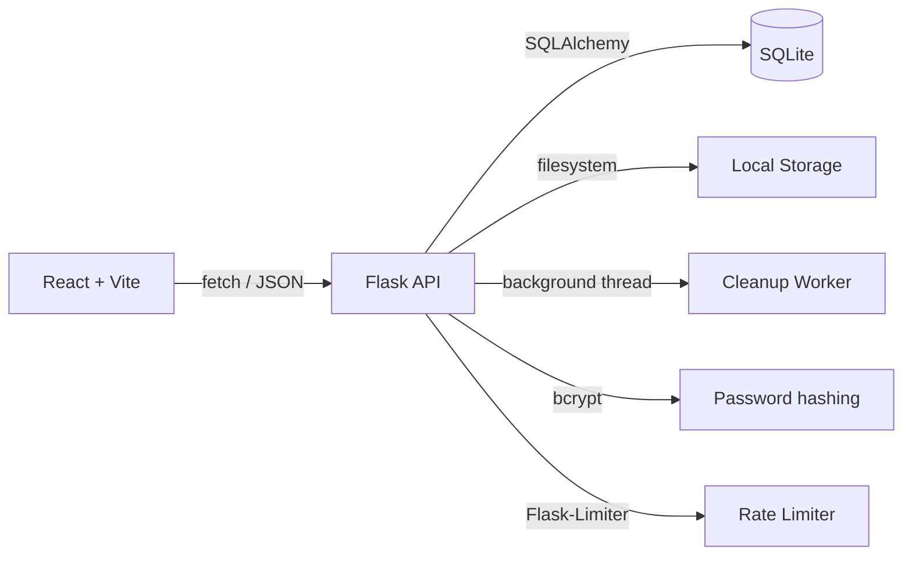

<div align="center">

<!-- Animated Header -->


<br/>

<!-- Animated Typing SVG -->
<a href="https://git.io/typing-svg"></a>

<br/>

<!-- Badges -->
<p>


</p>

<p>


</p>

</div>

---

<div align="center">

### 🚀 What is ShareNova?

**ShareNova** is a secure, temporary file and text sharing platform.
Create a text room or upload files → get a **6-digit code** → share the code → the recipient opens the content.
**No accounts. No public URLs. Everything auto-expires.**

</div>

---

## ✨ Features

<table>
<tr>
<td width="50%">

### 🔐 Security First
- **Code-only access** — 6-digit share codes, no guessable URLs
- **Password protection** with bcrypt hashing and short-lived session tokens
- **Magic-byte MIME validation** — blocks executables regardless of extension
- **Path-traversal-safe local storage** — storage paths never leave the server
- **Rate limiting** per endpoint tier (Flask-Limiter)

</td>
<td width="50%">

### ⚡ Simple Stack
- **Flask 3** backend on Python 3.12
- **SQLAlchemy 2** ORM on SQLite (no external database needed)
- **Background cleanup thread** every 5 minutes
- **Streaming uploads** straight to disk
- **Vite** dev server with hot reload

</td>
</tr>
<tr>
<td width="50%">

### 🎨 Premium UI
- **Glassmorphic dark/light theme** with noise texture
- **Framer Motion** animations throughout
- **Per-letter 3D animated** brand title with glow
- **Responsive** across all screen sizes
- **Delete confirmation UI** — destructive actions require an explicit "I agree" checkbox

</td>
<td width="50%">

### 🕐 Auto-Expiry
- **6 expiry tiers:** 30m, 1h, 6h, 24h, 7d, 30d
- **Automatic cleanup** of expired shares (DB rows *and* files on disk)
- **Session tokens** with a 15-minute sliding TTL
- **Countdown timer** driven by the server's real expiry time

</td>
</tr>
</table>

---

## 🏗️ Architecture



| Layer | Technology |
|:------|:-----------|
| **Frontend** | React 19 + Vite + JavaScript, Framer Motion, React Router 7 |
| **Backend** | Flask 3 (application factory + blueprints) |
| **ORM / DB** | SQLAlchemy 2 + SQLite |
| **CORS** | flask-cors |
| **Rate limiting** | Flask-Limiter |
| **Passwords** | bcrypt |
| **MIME check** | python-magic (libmagic) |
| **Storage** | Local filesystem only |
| **Config** | Environment variables / `backend/.env` (python-dotenv) |

---

## 📁 Project Structure

```
ShareNova/
├── frontend/                     # React + Vite (unchanged UI)
│   ├── src/
│   │   ├── components/           # common, editor, forms, share, shared, upload
│   │   ├── lib/                  # api.js, constants.js, uid.js, sessionPasswordManager.js
│   │   ├── pages/                # Home, Text (routed); Start, About (not routed)
│   │   ├── styles/               # Component CSS
│   │   ├── App.jsx               # React Router config
│   │   └── main.jsx
│   └── vite.config.js
│
└── backend/                      # Flask
    ├── main.py                   # Dev entry point (python main.py)
    ├── terminaUi.py              # Startup banner
    ├── requirements.txt          # Runtime dependencies
    ├── requirements-dev.txt      # + pytest
    ├── tests/test_api.py         # API test suite
    └── app/
        ├── __init__.py           # create_app() factory
        ├── config.py             # Env-based configuration
        ├── database.py           # Engine, scoped session, table creation
        ├── models.py             # Share, File, TextShare
        ├── errors.py             # JSON envelope + error handlers
        ├── extensions.py         # CORS + rate limiter
        ├── security.py           # Private-share access check, security headers
        ├── utils.py              # UTC time helpers
        ├── routes/
        │   ├── shares.py         # /api/shares/*
        │   ├── files.py          # /api/files/<id>/download, /api/download/<uid>/all
        │   └── health.py         # /api/health
        └── services/
            ├── share_service.py     # Share CRUD
            ├── storage_service.py   # Local file storage
            ├── password_service.py  # bcrypt + session tokens
            ├── cleanup_service.py   # Expired-share cleanup worker
            ├── uid_service.py       # 6-digit code generation
            └── validation.py        # Request + upload validation
```

---

## 🚀 Quick Start

### Prerequisites

- **Python 3.12+**
- **libmagic** (`sudo apt install libmagic1` on Debian/Ubuntu, `brew install libmagic` on macOS)
- **Node.js 20+**

### 1. Backend

```bash
cd backend
python3 -m venv .venv
source .venv/bin/activate          # Windows: .venv\Scripts\activate
pip install -r requirements.txt    # or requirements-dev.txt to also run tests
cp .env.example .env               # adjust as needed
python main.py
```

The API runs at `http://localhost:8000`. Tables are created automatically on startup
(SQLite at `backend/storage/sharenova.db`, uploaded files under `backend/storage/shares/`).

For production, set `APP_ENV=production` and run a single WSGI process (session tokens
and rate-limit counters are kept in memory), e.g.
`gunicorn -w 1 --threads 8 -b 0.0.0.0:8000 "app:create_app()"`.

### 2. Frontend

```bash
cd frontend
npm install
npm run dev
```

The app runs at `http://localhost:5173`.

### 3. Tests

```bash
cd backend
python -m pytest -q
```

---

## 🔑 Environment Variables

### Backend (`backend/.env`)

| Variable | Default | Purpose |
|:--|:--|:--|
| `APPNAME` | `ShareNova` | Name in the startup banner |
| `HOST` / `PORT` | `0.0.0.0` / `8000` | Bind address |
| `APP_ENV` | `development` | `production` disables auto-reload |
| `DATABASE_URL` | `sqlite:///storage/sharenova.db` | Relative paths resolve from `backend/` |
| `STORAGE_DIR` | `storage` | Local upload directory |
| `BCRYPT_ROUNDS` | `12` | bcrypt cost |
| `SESSION_TOKEN_TTL_SECONDS` | `900` | Password session lifetime (sliding) |
| `MAX_UPLOAD_BYTES` | `524288000` | Max total upload size per share |
| `MAX_FILES_PER_SHARE` | `20` | Max files per upload |
| `CLEANUP_INTERVAL_SECONDS` | `300` | Expired-share cleanup interval |
| `RATELIMIT_ENABLED` | `true` | Toggle rate limiting |
| `RATE_LIMIT_RETRIEVAL` / `_PASSWORD` / `_UPLOAD` / `_UPDATE` | `200/minute` / `50/10minutes` / `10/hour` / `120/minute` | Per-tier limits |
| `FRONTEND_URL` | `http://localhost:5173` | Allowed CORS origin(s), comma-separated |
| `TRUST_PROXY_HOPS` | `0` | Set to `1` behind a reverse proxy |

### Frontend (`frontend/.env`)

```env
VITE_projectName=ShareNova
VITE_API_URL=http://localhost:8000
```

---

## 📡 API Reference

All responses use the envelope `{"success": true, "data": ...}` or `{"success": false, "error": "...", "details"?: [...]}`.
Private shares require the `X-Session-Token` header (or `?token=` for download links).

| Method | Endpoint | Description | Rate tier |
|:-------|:---------|:------------|:-----------|
| `GET` | `/api/health` | Health + DB check | — |
| `GET` | `/api/shares/active?limit=` | Recent non-expired shares (metadata only) | retrieval |
| `POST` | `/api/shares/text` | Create text room → `uid` | upload |
| `PUT` | `/api/shares/text/{uid}` | Save room content (recreates a missing room) | update |
| `POST` | `/api/shares/file` | Upload files (multipart `files`, `expiresIn`, `password`) → `uid` | upload |
| `GET` | `/api/shares/{uid}` | Share metadata | retrieval |
| `POST` | `/api/shares/{uid}/verify` | Verify password → `sessionToken` | password |
| `GET` | `/api/shares/{uid}/content` | Text content | retrieval |
| `DELETE` | `/api/shares/{uid}` | Delete share and its files | update |
| `GET` | `/api/files/{id}/download` | Download one file | retrieval |
| `GET` | `/api/download/{uid}/all` | Download all files as ZIP | retrieval |
